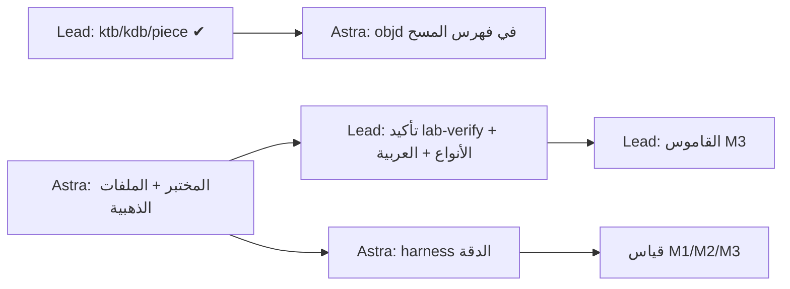

# الفريق — وكيلان على مستودع واحد (ADR-0006، معدّل 2026-10-15)

| الدور | الفرع | يملك (يكتب فيه وحده) |
|---|---|---|
| **Lead — المدير + "صحة البيانات"** (الوكيل الحالي) | `lead/*` ← PR إلى `main` | العقود: `bytes.rs` `error.rs` `block.rs` `source.rs` · طبقة الكتلة والصفوف `row/` · الأنواع `types/` · الترميز `charset/` · القاموس `dict/` (M3) · الاستدلال `infer/` (M4) · `docs/` · المراجعة والدمج |
| **Astra — "المنصة والدليل"** (GPT Astra) | `agent/astra` (+ `agent/astra/<feature>`) | المسح والأداء `scan*` `header*` `benches/` · سطر الأوامر `odr-cli/` · المختبر `lab/` · القياس `bench/` · `odr-testkit/` · `fuzz/` · `ci/` |

**لماذا هذا التقسيم؟**
- **حدود نظيفة:** Lead يملك "ماذا تعني البايتات" (تنسيق أوراكل والقيم)، وAstra يملك "كيف نقرأها بسرعة ونثبت صحتها" (I/O، توازي، Windows، مختبر، قياس). التقاطع الوحيد: Astra يستدعي `row::ktb::data_object_id()` من Lead — عقد ثابت.
- **المختبر عند Astra:** بيئة Lead بلا Docker، والمختبر يحتاج Oracle Free في حاوية (أو على Windows لدى المالك).
- **الاستقلال:** Astra يُخرج الملفات الذهبية (الحقيقة)، وLead يكتب المفكّكات — فلا أحد يصحّح نفسه بنفسه (فصل "من يبني" عن "من يقيس").
- **أعلى خطر = أقرب للمدير:** خطأ قيمة في جدول محاسبي هو أسوأ فشل للمنتج، لذا فكّ القيم عند المدير مباشرة.

## ملف المهمة
- **Astra:** البرومبت الدقيق `docs/agents/ASTRA_PROMPT.md` ← انسخه كما هو كأول رسالة للوكيل (قائمة المهام التفصيلية في `ASTRA.md`).
- **Lead:** `docs/agents/LEAD.md` (خطة المدير، للشفافية).

## قواعد مشتركة
1. اقرأ بالترتيب: `AGENTS.md` ← `STATUS.md` ← `docs/adr/0005` ← `docs/adr/0006` ← ملفك.
2. لا تكتب خارج ملكيتك. تحتاج تغييراً في عقد؟ افتح issue بعنوان `contract: …` واستمر بحل مؤقت داخل منطقتك.
3. قبل كل PR: `git fetch origin && git rebase origin/main` ثم البوابات الخمس:
   ```
   cargo fmt --all -- --check
   cargo clippy --workspace --all-targets -- -D warnings
   cargo test --workspace
   RUSTDOCFLAGS="-D warnings" cargo doc --workspace --no-deps
   cargo deny check
   ```
4. PR صغير لكل مهمة، عنوان Conventional Commit، يربط REQ-…، قالب الـ PR كاملاً. Lead يراجع ويدمج؛ PRs الـ Lead يراجعها المالك أو Astra (مراجعة متبادلة).
5. سطرك في `STATUS.md` ← "قيد العمل" محدّث دائماً. مشكلة > 30 دقيقة ← `LESSONS.md`.
6. لا رقم (سرعة/دقة) إلا من `bench/` مع الجهاز والبذور.
7. لا تخمين في البنى الثنائية: كل ثابت له مصدر أو يُوسم `lab-verify` ويُسجّل في `docs/design/lab-verify.md`.

## التبعيات

