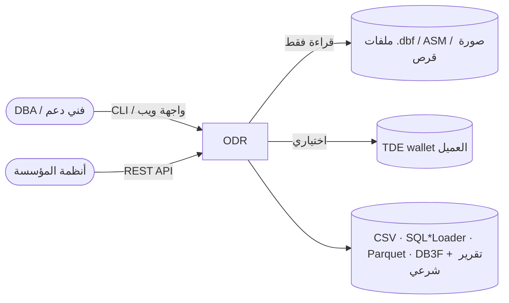
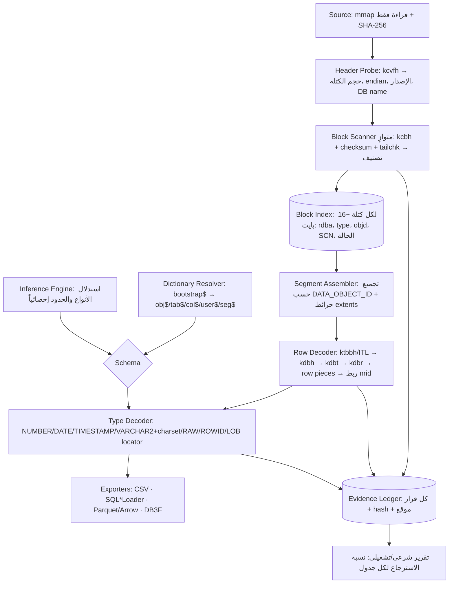

# المعمارية — Oracle Datafile Recovery v0.x (مقترحة)
1. **الأهداف والقيود**
   - **الصحة قبل كل شيء**: صف مستخرج بقيمة خاطئة أسوأ من صف مفقود (لا تخمين صامت؛ كل قيمة مشكوك فيها تُعلَّم).
   - **المتانة**: لا يتوقف المسح ولا ينهار على أي بايتات (مدخلات معادية افتراضياً).
   - **الأداء**: المسح محدود بسرعة القرص لا بالمعالج — هدف ≥ 300 MB/s/نواة، وخطي مع عدد الأنوية؛ ملف 1 TB في < 30 دقيقة على NVMe.
   - **الشرعية**: الدليل لا يُعدَّل أبداً؛ كل مخرَج قابل للتتبع إلى (ملف، كتلة، slot) مع hash.
   - **القيود**: بلا instance أوراكل، بلا اتصال شبكي، يعمل على Linux وWindows، الإصدارات 8i–26ai، little/big endian.
2. **السياق (C4 L1)**

3. **الحاويات (C4 L2)**
   - `odr-core` — مكتبة النواة (Rust مقترح، ADR-0001): كل التحليل الثنائي، بلا I/O شبكي.
   - `odr-cli` — سطر أوامر فوق النواة (أول واجهة).
   - `odr-py` — ربط بايثون (PyO3) لمحرّك الاستدلال والبحث والتجارب.
   - `odr-server` — REST API + واجهة ويب (M7)، يشغّل النواة في عملية معزولة لكل حالة.
   - `lab/` + `bench/` — مختبر Oracle Free، مولّد التلف، المجموعة الذهبية، قياس الدقة والأداء (ADR-0004).
4. **المكوّنات (C4 L3) — خط معالجة من مرحلتين**

   - **المرحلة 1 (Scan)**: مرور واحد تسلسلي على الملف، متوازٍ بالقطع، لا يفكّ الصفوف؛ ينتج فهرساً صغيراً. يكفي وحده لإصدار "تقرير قابلية الاسترجاع" قبل أي عمل (قيمة تجارية مباشرة: العميل يعرف ماذا سيسترجع قبل أن يدفع).
   - **المرحلة 2 (Extract)**: فكّ الكائنات المطلوبة فقط من الفهرس — لا نفكّ ما لا يلزم.
   - **Header Probe** لا يثق برأس الملف: إن تلف (فدية) يُستدلّ على حجم الكتلة وendian من توقيعات kcbh المتكررة في المسح.
5. **السيناريوهات**
   - *SYSTEM سليم + كتل متفرقة تالفة*: Scan ← Dictionary ← Extract؛ الكتل التالفة تُتجاوز وتُذكر في التقرير بـ (rdba، الجدول، تقدير الصفوف المفقودة).
   - *SYSTEM مفقود*: Scan ← Inference يقترح المخطط لكل objd مع درجة ثقة ← المستخدم يؤكد/يسمّي ← Extract. لاحقاً: مطابقة مع مخططات معروفة (أنظمة يمن سوفت) للتسمية آلياً.
   - *فدية/قرص خام*: Scavenge = مسح بكل الإزاحات المحتملة عن توقيع kcbh صالح بالـ checksum، ثم نفس الخط.
6. **النشر** — ثنائي واحد بلا اعتماديات (CLI) + صورة حاوية للخادم؛ تشغيل محلي فقط (SECURITY.md).
7. **المفاهيم المشتركة**
   - **قارئ بايتات آمن**: كل وصول عبر `Cursor` مقيّد الحدود يعيد `Result`؛ لا `unsafe` في المحلّلات؛ fuzz لكل بنية.
   - **Endianness** مجرّدة في القارئ (`ByteOrder` تُحدد مرة من الرأس).
   - **الثقة**: كل صف/قيمة يحمل `confidence` و`provenance` (ملف، rdba، slot، SCN).
   - **تعدد الإصدارات**: عند وجود أكثر من نسخة لنفس الكتلة (نسخ ملفات/ASM mirror) يُختار الأعلى SCN مع checksum صالح، ويُسجَّل القرار.
   - **الترميز**: تحويل charset (AR8MSWIN1256، AL32UTF8، WE8MSWIN1252…) حسب القاموس أو يحدده المستخدم؛ البايتات الخام تُحفظ بجانب النص عند الشك.
8. **المخاطر والدين التقني**
| الخطر | الاحتمال | الأثر | الخطة |
|---|---|---|---|
| تنسيقات غير موثّقة رسمياً تختلف بين الإصدارات | عالٍ | عالٍ | مجموعة ذهبية لكل إصدار (11g، 12c، 19c، 23ai) قبل ادعاء الدعم |
| قيم خاطئة بصمت (أخطر من الفقد) | متوسط | حرج | مقارنة bit-exact مع ground truth في CI؛ تعليم القيم غير المؤكدة |
| الاستدلال يتفوق على بيانات الضبط فقط | عالٍ | عالٍ | hold-out schemas + بذور متعددة (ADR-0004، LESSONS) |
| الضغط OLTP/HCC معقّد | عالٍ | عالٍ | Basic/OLTP في M5؛ HCC (Exadata) خارج النطاق حتى يطلبه عميل |
| تلوث ترخيصي (AGPL/بلا ترخيص) | منخفض | عالٍ | Clean-room (ADR-0003)؛ مراجعة في قالب PR |
| أداء بايثون على تيرابايت | — | عالٍ | النواة بـ Rust؛ بايثون للاستدلال فقط |
9. **المصطلحات** — *كتلة* = وحدة I/O (2–32K) · *RDBA* = عنوان الكتلة النسبي (ملف+رقم) · *objd* = DATA_OBJECT_ID في kdbh يربط الكتلة بمقطعها · *row piece* = قطعة صف (قد يتسلسل عبر nrid) · *القاموس* = جداول SYS في SYSTEM.DBF · *Scavenge* = نحت كتل بلا رأس ملف موثوق · *المجموعة الذهبية* = ملفات مرجعية بحقيقة معروفة.
